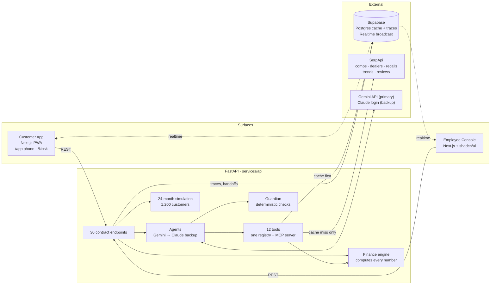
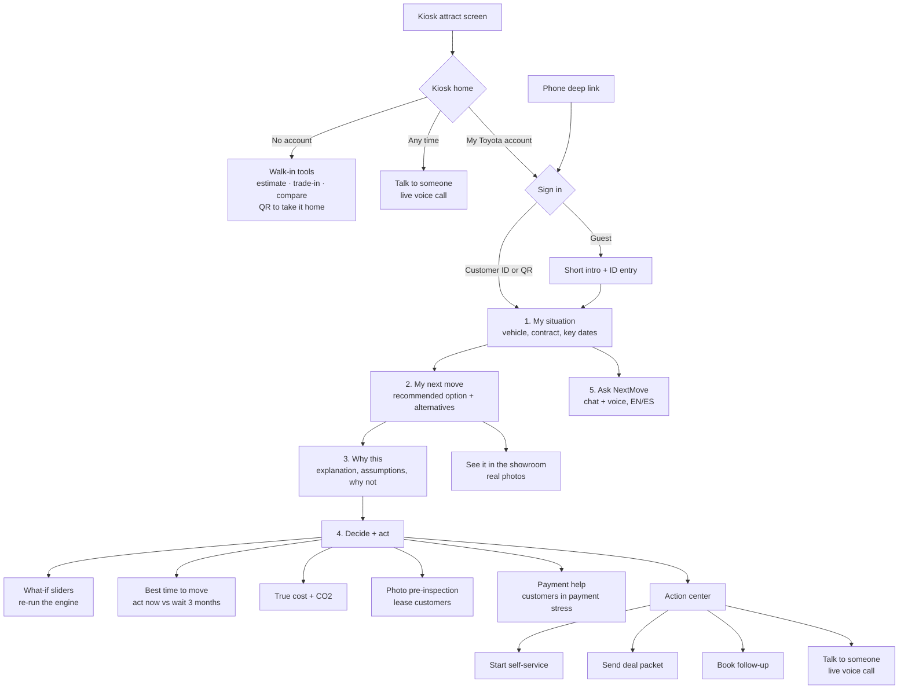
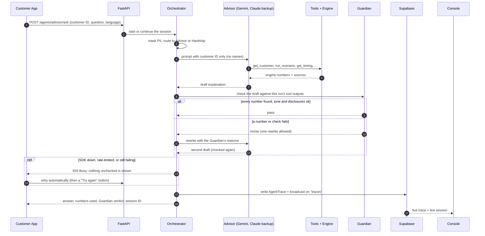
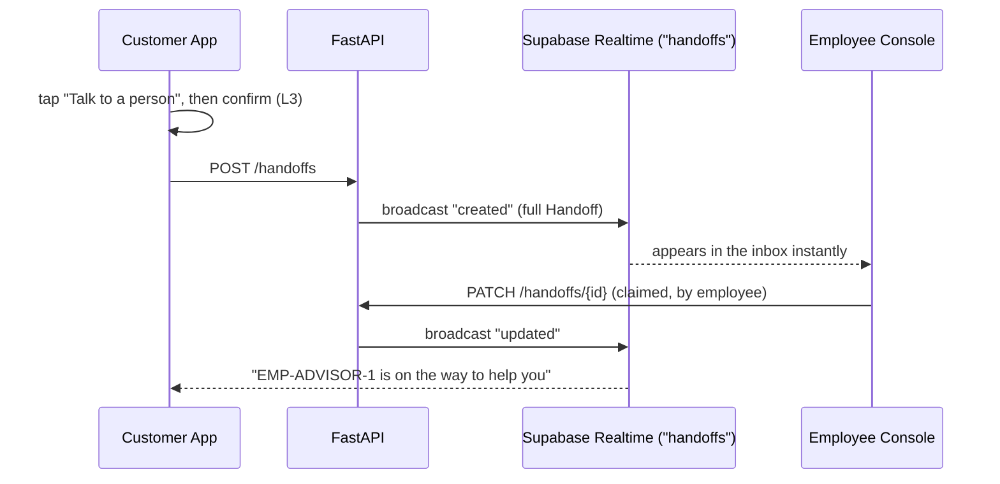
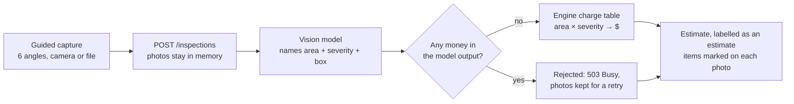
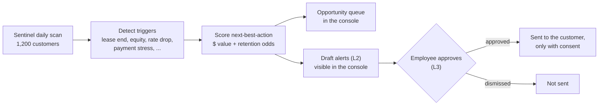
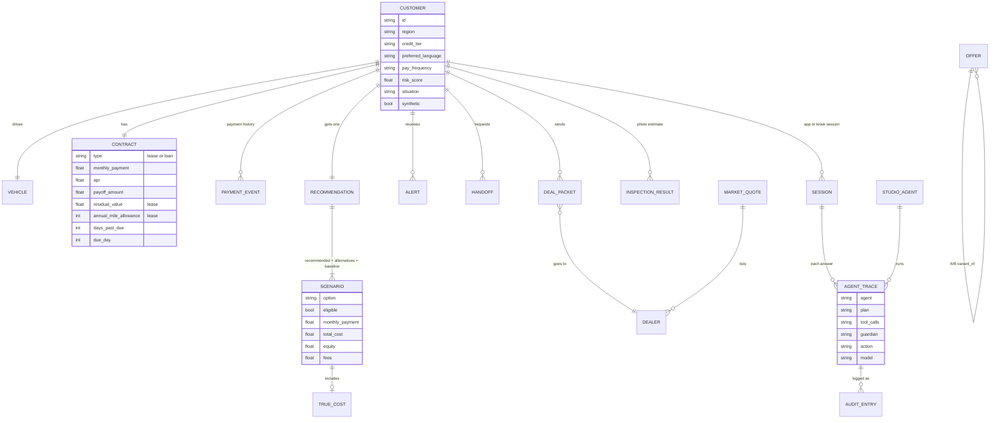

# Toyota NextMove

**A proactive, agentic financial co-pilot for Toyota Financial Services (TFS) customers.** Built at HackTX.

> "Given my situation today, what's the smartest next move for me and my Toyota?"

**Try it now (mock data, no setup):** [Customer App](https://toyota-nextmove-customer.vercel.app) · [Kiosk](https://toyota-nextmove-customer.vercel.app/kiosk) · [Sameera on the phone app](https://toyota-nextmove-customer.vercel.app/app?id=CUST-SAMEERA2026) · [Employee Console](https://toyota-nextmove-console.vercel.app)

The hosted copies run on recorded mock data. The live engine, agents and realtime run on the demo laptop.

**Team:** Vishva Patel · Vishwaa Shah · Sameeraa K · Hung

---

## Contents

1. [The problem](#the-problem)
2. [What NextMove does](#what-nextmove-does)
3. [Track coverage](#track-coverage)
4. [Architecture](#architecture)
5. [How it works: flows](#how-it-works-flows)
6. [Trust and responsible AI](#trust-and-responsible-ai)
7. [Results: proof of value](#results-proof-of-value)
8. [Data model](#data-model)
9. [API reference](#api-reference)
10. [Master data](#master-data)
11. [Agents and tools](#agents-and-tools)
12. [Screens](#screens)
13. [Run it](#run-it)
14. [Repository layout](#repository-layout)
15. [How we built it](#how-we-built-it)
16. [Limits and honest notes](#limits-and-honest-notes)
17. [Team](#team)

---

## The problem

TFS customers decide too late. A lease ends, miles run over, a payment slips, and by the time anyone notices, the best option is gone. Options are confusing, so every question becomes a phone call. Payment stress is caught after the damage is done.

## What NextMove does

NextMove watches each customer's situation, reaches out at the right moment, compares every eligible option with exact numbers, and guides them to **one clear next step**. Employees see the whole portfolio, the profit impact, and every AI decision.

| Persona | Situation | What NextMove shows (live engine output) |
| --- | --- | --- |
| **Vishwaa** | Lease ends in 90 days, 9,800 miles over the allowance | **Buy it.** The buyout keeps **$6,467** of equity; returning it costs **$3,200** in fees. Photo pre-inspection estimates wear charges before the official inspection. |
| **Sameera** | Loan with positive equity, high fuel spend | **Upgrade to a Camry SE Hybrid** (real **$32,200** MSRP from toyota.com via SerpApi). Payment **$496 → $403/mo**, true monthly cost **$847 → $660**, **1,718 kg less CO2/year**. Acting now is worth **$820** more than waiting 3 months. See it in the showroom, then send a deal packet to the dealer. |
| **Hung** | Missed a payment after a job change | **Move the due date to the 17th** to match the biweekly payday. Deferral and extension are money decisions, so they go to a **human callback**, never an agent. |

**Two surfaces, one brain:**
- **Customer App:** phone mode and dealership kiosk mode, English and Spanish, voice, a showroom with real car photos.
- **Employee Console:** portfolio, live activity, proof of value, responsible AI, Agent Studio.

## Track coverage

| Requirement | How NextMove meets it |
| --- | --- |
| Personalize | Customer 360 built from contract, mileage, payment history and life events |
| Simplify | The engine computes every option; the AI explains assumptions, trade-offs and why not the others |
| Guide | One recommended next step with a single action, plus the alternatives side by side |
| Value | 24-month simulation over 1,200 customers: retention **54.4% → 68.6%** at 60% adoption, with live assumption sliders |
| Working prototype | Both surfaces on one live API, with realtime handoffs between them |
| Generated data | 1,200 seeded customers; no real customer data (no on-screen demo label, by team decision) |
| Responsible AI | Guardian, autonomy levels, fairness report, audit log with overrides, deploy gate |
| Reimagine CX | Proactive alerts, voice EN/ES, dealership kiosk, photo pre-inspection, showroom with real photos, AI-written explanations |
| Reusable agent platform | Agent Studio: templates, tool registry, guardrails, traces, evals. A Recall Notifier deploys from a template in about 12 s |
| Enterprise grade | Role switcher, secrets only in env files, prompt-injection deploy gate, PII masking |
| Meaningful SerpApi use | Market value is the median of real cached comps (source + as-of on every number); dealers, recalls, trends and reviews drive real decisions |

---

## Architecture



**Design rules (from [CLAUDE.md](CLAUDE.md)):**
1. **The engine computes every number.** The LLM only explains engine output and never produces a payment, cost, equity, fee or rate.
2. **Guardian runs before any agent output reaches a customer.** Every number must exist in that run's tool output; otherwise the answer is sent back or blocked.
3. **Autonomy levels:** L1 read = automatic; L2 draft = automatic and visible in the console; L3 customer-facing = consent or employee approval; L4 money or credit decision = never an agent.
4. **No protected attributes** anywhere in data or engine.
5. **Generated data only**, never real customer data.
6. **PII masking:** customer IDs, not names, go to the model; PII is masked in logs.
7. **Secrets live only in `.env.local`** (gitignored).
8. **Mock first:** both frontends work fully on MSW mocks generated from the same contract.
9. **Every SerpApi call is cached** with a timestamp; the demo personas work offline.
10. **Every market number shows its source and as-of time.**

### Tech stack

| Layer | Technology |
| --- | --- |
| Console | Next.js 16 (App Router), TypeScript, shadcn/ui, Tailwind 4, TanStack Table, Recharts, Framer Motion |
| Customer App | Next.js 16 PWA, TypeScript, Tailwind 4, Framer Motion, official Toyota imagery and logo from toyota.com (sponsor permission), lucide icons, Web Speech API, `uqr` (on-device QR) |
| API | Python 3.12, FastAPI, Pydantic v2 (generated from the contract), pytest, ruff, uv |
| AI | Gemini (primary, REST + function calling) and the Claude Agent SDK (backup, subscription login), both locked to our tool registry; MCP server for the tools |
| Data and realtime | Supabase Postgres (SerpApi cache, traces) and Realtime Broadcast (`handoffs`, `traces`) |
| Market data | SerpApi: Google Search, Google Maps, Maps Reviews, Google News, Google Trends, YouTube |
| Contract and mocks | OpenAPI 3.1 → `openapi-typescript` types, `datamodel-codegen` Pydantic models, MSW handlers |
| Monorepo and hosting | pnpm workspaces; frontends on Vercel (mock mode), live stack on the demo laptop |

---

## How it works: flows

### Customer journey



Every action needs the customer's tap plus a confirmation (L3), and confirmed actions are recorded with TFS (they show in the console's audit log). After 60 seconds idle the kiosk resets to the attract screen and clears everything. "Continue on your phone" shows a QR code generated on the device.

### Voice call (kiosk or phone, one service with the console)

```mermaid
sequenceDiagram
  participant C as Customer (kiosk mic)
  participant API as FastAPI /voice
  participant G as Gemini Live
  participant T as Engine tools
  participant GD as Guardian
  participant E as Console (Live calls)
  C->>API: Talk to someone (ringback plays)
  API->>G: setup: advisor prompt + tool registry, customer ID only
  G-->>C: greeting (native audio)
  C->>API: speech (PCM 16 kHz)
  API->>G: audio
  G->>API: tool call (run_scenario …)
  API->>T: same registry as every agent
  T-->>G: engine numbers
  G-->>C: spoken answer (24 kHz) + captions
  API->>GD: each finished agent turn
  GD-->>API: pass, or flag → agent corrects itself out loud
  API-->>E: transcript + Guardian flags (Realtime `calls`)
  E->>API: Take over
  API-->>C: "Alex from TFS joined"; AI leaves; claimed handoff
  E->>API: typed message
  API-->>C: shown + read aloud
```

A caller who isn't signed in can say their first name (or customer ID) and which Toyota they drive; the `identify_customer` tool must match both, and from then on every account tool is pinned to that customer. A rep's typed messages are spoken in a natural Gemini TTS voice. The browser never sees the Gemini key. Speech can't be held for review, so the Guardian checks each finished agent turn immediately; a failed turn is flagged on screen and in the console, and the agent is told to correct itself (see DECISIONS). Walk-in guests can call too, with estimate and market tools only.

### Advisor question (agent flow)



### Talk to a person (realtime handoff)



### Photo pre-inspection



### Proactive outreach (Sentinel)



---

## Trust and responsible AI

### Autonomy levels

| Level | Meaning | Examples in NextMove |
| --- | --- | --- |
| **L1** read / analyze | Runs automatically | `get_customer`, `run_scenario`, `get_market_value`, `get_timing`, `inspect_photos` |
| **L2** draft | Runs automatically and is visible in the console | Sentinel outreach drafts, `create_offer_draft` |
| **L3** customer-facing | Needs the customer's consent or an employee's approval | `book_appointment`, `handoff_to_human`, sending an alert, deal packets, self-service |
| **L4** money or credit decision | Never an agent | Deferrals and extensions for customers in payment stress go to a human |

Agents can only call L1 and L3 tools; there is no L4 tool. The SDK is locked down: no built-in Claude Code tools (no shell, files or web), no settings files, only our 12-tool registry. A test fails if any built-in tool is reachable.

### The Guardian

Deterministic code, not an LLM. For every agent answer it checks:

| Check | What it does |
| --- | --- |
| `numbers_match_tools` | Every number in the answer must appear in that run's tool output (with formatting tolerance). An invented number fails. |
| `tone` | No pressure or guarantees, in English and Spanish |
| `consent` | No promises of actions the customer hasn't agreed to |
| `disclosures` | Estimates are labelled as estimates |
| `fairness` | No protected attributes in the answer |
| `prompt_injection` | Customer messages that try to override instructions are caught |

Verdicts are `pass`, `revise` (one rewrite allowed) or `block`. Each answer lists the **numbers used** with the tool that produced each one.

### Fairness report (live, at defaults)

Recommendation and offer rates by group; a group is flagged if it's more than 5 points off its dimension's overall rate. **No group is flagged.**

| Dimension | Group | Customers | Recommendation rate | Offer rate |
| --- | --- | ---: | ---: | ---: |
| Region | Midwest | 289 | 62.3% | 1.7% |
| Region | Northeast | 297 | 62.3% | 1.0% |
| Region | South | 295 | 62.7% | 3.7% |
| Region | West | 319 | 59.6% | 1.6% |
| Credit tier | A | 433 | 63.5% | 1.8% |
| Credit tier | B | 391 | 59.3% | 1.8% |
| Credit tier | C | 250 | 62.4% | 2.4% |
| Credit tier | D | 126 | 61.1% | 2.4% |

Region and credit tier are the only dimensions; the data has no protected attributes.

### Audit and overrides

Every tool decision and agent trace lands in the audit log (`GET /audit`). Employees can approve or override a recommendation; an override needs a reason, and an agent can never review its own recommendation.

### Deploy gate (Agent Studio)

New agents deploy only if they pass: a tool-policy check, the three persona evals (engine pick + Guardian on each persona's live AI explanation), and six prompt-injection tests. The default gate makes no live model calls; `STUDIO_GATE_LIVE=1` adds the persona cases on the live model.

---

## Results: proof of value

24-month simulation over all 1,200 generated customers, baseline vs NextMove, at the default assumptions (60% adoption, 90-day outreach lead, 50% hardship uptake). Deterministic and seeded: the same inputs always give the same numbers.

| KPI | Baseline | NextMove | Change |
| --- | ---: | ---: | ---: |
| Retention | 54.4% | 68.6% | +14.1 pts |
| Calls per 100 customers | 184.9 | 147.6 | −37.3 |
| Serious delinquency | 4.49% | 4.04% | −0.45 pts |
| Revenue (TFS margin) | $531,612 | $781,016 | +$249,404 |
| Cost to serve | $19,966 | $16,307 | −$3,659 |
| Avg. lifetime value | $426 | $637 | +$211 |
| Loyalty revenue | $600,788 | $799,742 | +$198,954 |

All three assumptions are live sliders on the Proof page; each move re-runs the simulation (about 2 ms).

---

## Data model



The full schema (25+ types) is in [`packages/contracts/openapi.yaml`](packages/contracts/openapi.yaml), the single source of truth. TypeScript types and Pydantic models are generated from it, so the frontends and the API can't drift apart. A test fails if any contract operation has no API route.

**Situations:** `lease_end`, `mileage_overage`, `positive_equity`, `rate_drop`, `early_payoff`, `life_event`, `payment_stress`, `ev_switch`, `none`.

**Options:** `do_nothing` (always the baseline), `keep`, `buyout`, `return`, `new_lease`, `refinance`, `trade_in`, `extend`, `upgrade`, `pay_extra`, `pay_off`, `due_date_change`, `deferral`.

---

## API reference

All 34 operations of the contract are implemented, plus the `/voice/{customer_id}` WebSocket.

| Method | Path | Used by | Purpose |
| --- | --- | --- | --- |
| GET | `/health` | both | Health check |
| GET | `/customers?q=` | both | Search customers by ID or name |
| GET | `/customers/{id}` | both | Customer 360 |
| GET | `/customers/{id}/recommendation` | both | Recommended option, alternatives, why / why not |
| POST | `/customers/{id}/recommendation/review` | console | Approve or override (reason required) |
| POST | `/customers/{id}/actions` | app | Record the customer's confirmed self-service start or due-date change (L3) |
| GET | `/customers/{id}/timing` | app | Month-by-month best time to move |
| POST | `/scenarios` | both | Run options, with what-if overrides |
| POST | `/agents/advisor/ask` | app | Ask NextMove (live agent + Guardian) |
| POST | `/inspections` | app | Photo pre-inspection (multipart) |
| GET / POST | `/handoffs` | both | List or create a talk-to-a-person request |
| PATCH | `/handoffs/{id}` | console | Claim or resolve |
| GET / POST | `/deal-packets` | both | List or send a deal packet to a dealer |
| GET | `/alerts?customer_id=&status=` | both | Alerts inbox / approvals |
| PATCH | `/alerts/{id}` | both | Approve (employee only), send, dismiss, consent |
| GET | `/sessions` | console | Live customer sessions |
| GET | `/opportunities` | console | Queue with next-best-action $ value and retention odds |
| GET / POST | `/offers` | console | Offer rules and A/B variants |
| POST | `/offers/{id}/simulate` | console | Simulate acceptance, profit and retention lift |
| GET | `/kpis?adoption_rate=&outreach_lead_days=&hardship_uptake=` | console | Baseline vs NextMove simulation |
| GET | `/traces?customer_id=` | console | Agent traces |
| GET | `/audit` | console | Audit log |
| GET | `/fairness` | console | Fairness report |
| GET | `/market/{model}?year=` | both | Market quote: comps, trend, recalls, dealers, reviews |
| GET / POST | `/studio/agents` | console | List or create agents from templates |
| POST | `/studio/agents/{id}/deploy` | console | Deploy through the gate |

**Realtime channels (Supabase Broadcast):** `handoffs` (events `created`, `updated`) and `traces` (event `created`), each carrying the full contract object.

---

## Master data

Every number below lives in config, not code: [`services/api/engine/config.toml`](services/api/engine/config.toml) and [`eligibility.toml`](services/api/engine/eligibility.toml). All values are synthetic and documented.

### Generated portfolio

1,200 customers from a fixed seed ([`sim/generator.py`](services/api/sim/generator.py)), with no protected attributes.

| Breakdown | Counts |
| --- | --- |
| Contract type | 505 leases · 695 loans |
| Model | Prius 226 · Tacoma 207 · Camry 202 · Highlander 195 · RAV4 190 · bZ 180 |
| Situation | Positive equity 363 · Rate drop 262 · Mileage overage 232 · None 222 · Payment stress 72 · Life event 25 · Lease end 24 |
| Credit tier | A 433 · B 391 · C 250 · D 126 |
| Region | West 319 · Northeast 297 · South 295 · Midwest 289 |

978 customers have an opportunity in the console queue.

### Demo personas

| | Vishwaa (`CUST-VISHWAA2026`) | Sameera (`CUST-SAMEERA2026`) | Hung (`CUST-HUNG2026`) |
| --- | --- | --- | --- |
| Vehicle | 2024 RAV4 XLE, gas, 41,200 mi | 2022 Camry SE, gas, 48,900 mi | 2023 Prius LE, hybrid, 31,500 mi |
| Contract | Lease, $389/mo, 36 months, 33 paid | Loan, $496/mo at 5.9%, 72 months, 49 paid | Loan, $468/mo at 4.9%, 60 months, 43 paid |
| Key facts | Residual $22,450 · 12,000 mi/yr allowance · $0.25/mi over · projected 45,800 mi | Payoff $10,760 · longer commute | Payoff $7,640 · 19 days past due · paid biweekly · new job |
| Recommendation | Buyout: $444.07/mo, keeps $6,467 equity, $300 fee | Upgrade to Camry SE Hybrid ($32,200 real MSRP): $403.24/mo, $650 fees | Due date to the 17th: $468/mo, no extra cost |
| Alternatives | Return ($3,200 fees) · Trade in · Extend 6 mo · Upgrade to RAV4 XLE Hybrid | Refinance ($493.50/mo) · Trade in · Extend 12 mo ($335.39/mo) | Extend 12 mo ($279.89/mo) · Defer one payment (human decision) |
| Act now vs wait 3 months | +$721 | +$820 | +$841 |

### Rates by credit tier (APR %)

| Use | A | B | C | D |
| --- | ---: | ---: | ---: | ---: |
| Lease buyout financing | 6.4 | 7.9 | 10.9 | 14.9 |
| Refinance | 5.4 | 6.9 | 9.9 | 13.9 |
| New-vehicle financing | 5.9 | 7.4 | 10.4 | 14.4 |

### Fees and terms

| Fee | $ | Term | Months |
| --- | ---: | --- | ---: |
| Lease purchase option | 300 | Buyout financing | 60 |
| Lease disposition | 350 | Upgrade financing | 60 |
| Default wear estimate (before inspection) | 400 | Lease extension | 6 |
| Dealer doc + acquisition | 650 | Loan extension | 12 |
| Late fee (after 10 days) | 50 | Max total loan term | 84 |
| Refinance, extension, due-date change | 0 | | |

### Market value

- **With comps:** median of at least 3 cached SerpApi comps for the model-year, adjusted $0.10 per mile above or below 12,000 mi/year.
- **Fallback:** base-trim MSRP × retention by age (1.00, 0.90, 0.84, 0.80, 0.76, 0.71, 0.66, 0.61, 0.56, 0.52, 0.48), same mileage adjustment.
- **Real MSRPs** come from SerpApi Google searches (toyota.com preferred), cached with source and date. The prices below are the configured fallbacks used when no MSRP is found.

| Model | MSRP | Upgrade target | Price | MPG / MPGe |
| --- | ---: | --- | ---: | ---: |
| Camry | $29,500 | Camry SE Hybrid | $33,500 | 51 |
| RAV4 | $34,500 | RAV4 XLE Hybrid | $36,800 | 41 |
| Tacoma | $36,500 | Tacoma TRD Sport i-FORCE MAX | $46,500 | 23 |
| Highlander | $42,000 | Highlander XLE Hybrid | $47,500 | 35 |
| Prius | $29,500 | bZ XLE (EV) | $37,500 | 114 |
| bZ | $40,000 | bZ XLE (EV) | $37,500 | 114 |

### True cost and CO2 inputs

| Input | Value |
| --- | --- |
| Gas price | $3.40/gal |
| Electricity | $0.16/kWh (33.7 kWh per gallon-equivalent) |
| CO2 | 8.887 kg/gal (EPA tailpipe) · 0.37 kg/kWh (US grid) |
| Maintenance | Gas $85 · Hybrid $45 · EV $35 per month |
| Insurance estimate | Camry $145 · RAV4 $150 · Tacoma $165 · Highlander $175 · Prius $140 · bZ $160 per month |

### Eligibility rules

An option is shown only if every rule passes; otherwise the customer sees the first failing rule's reason.

| Option | Rules |
| --- | --- |
| Keep | Leases can't be kept past the end date |
| Buyout / Return / Lease extend | Leases only; opens 180 days before the lease ends |
| Refinance | Loans only; today's rate at least 0.5 points lower; balance not too small; 12+ payments left; account current |
| Trade in | Positive equity; account current |
| Upgrade | Negative equity no more than $2,000; account current |
| Loan extend | Total term can't exceed 84 months |
| Due-date change | Only when a payment is late or missed |
| Deferral | Loans only; late or missed payment; not over 60 days past due; enough payments left. Always decided by a human |

### Next-best-action scoring

- **Retention odds:** logistic of situation intercept + 0.35 × equity per $10k + 0.8 × on-time share − 0.9 × days past due per 30 + an option weight, clamped to 5%–95%. No credit tier, no protected attributes.
- **Expected value:** retention odds × 6% margin × monthly payment × horizon, plus for payment stress, payoff × cure lift × 45% loss given default.

| Situation intercept | Option weight |
| --- | --- |
| Lease end 0.6 · Mileage overage 0.5 · Positive equity 0.4 · Rate drop 0.3 · EV switch 0.3 · Payment stress 0.2 · Life event 0.2 · Early payoff 0.0 | Upgrade 0.6 · Due-date change 0.6 · Buyout 0.5 · Refinance 0.5 · Deferral 0.4 · Trade in 0.3 · Extend 0.3 · Keep 0.0 · Do nothing −0.4 · Return −0.8 |

### Simulation coefficients

| Coefficient | Value | Why |
| --- | --- | --- |
| Horizon | 24 months | Covers a full lease cycle |
| Outreach reach | 1 − e^(−lead / 60 days) | 30 days ≈ 39%, 90 days ≈ 78%, 180 days ≈ 95% |
| Baseline retention by situation | 40%–55% | Industry-style return-to-brand rates |
| Delinquency roll rate | risk score × 10% (current) · 60% (past due) | Past-due accounts roll far more often |
| Calls | 1.5 per decision · 3.0 per stressed account · 0.3 routine | Contact patterns around decisions |
| Deflection | 50% self-service · 60% hardship path | Calls avoided when customers act in the app |
| Cost | $9 per call · $0.40 per digital touch | Cost to serve |
| Fairness threshold | 5 points | Flags a group off its dimension's overall rate |

### Photo inspection charges ($, by severity)

| Area | Minor | Moderate | Major |
| --- | ---: | ---: | ---: |
| Front / rear bumper | 150 | 350 | 700 |
| Hood, roof | 125 | 300 | 650 |
| Quarter panel | 125 | 300 | 650 |
| Door | 100 | 250 | 600 |
| Fender, liftgate | 100 | 250 | 550 |
| Mirror | 50 | 125 | 300 |
| Windshield | 0 | 150 | 450 |
| Window | 0 | 100 | 300 |
| Headlight | 0 | 150 | 400 |
| Taillight | 0 | 125 | 300 |
| Wheel | 0 | 150 | 300 |
| Tire | 0 | 175 | 225 |
| Seat | 0 | 150 | 400 |
| Dashboard | 0 | 150 | 350 |
| Carpet | 0 | 100 | 250 |

Minor wheel and interior wear sits inside normal-wear standards, so it's $0. Photos: up to 6, 5 MB each, JPEG/PNG/WebP, 25 s timeout.

---

## Agents and tools

| Agent | Runs | Does | How |
| --- | --- | --- | --- |
| Orchestrator | Every request | Routes, keeps session context, enforces autonomy, writes traces | Code |
| Advisor | App, kiosk, voice | Answers questions from engine output | Gemini → Claude |
| Voice agent | "Talk to someone" (kiosk, app) | Live voice call over the same tools; Guardian on every turn; a rep can take over | Gemini Live |
| Hardship | Payment stress | Proposes policy-limited options, escalates L4 to a human | Gemini → Claude |
| Inspector | Photo pre-inspection | Names wear items; charges come from the engine | Gemini → Claude (vision) |
| Sentinel | At startup / daily | Detects triggers, ranks the queue, drafts outreach (L2) | Code |
| Market Intel | On demand | Refreshes SerpApi data into the cache | Code |
| Guardian | Before any output | Numbers, tone, consent, disclosures, fairness, injection | Code |

| Tool | Level | What it returns |
| --- | --- | --- |
| `get_customer` | L1 | Customer with PII masked |
| `run_scenario` | L1 | Engine options, totals, equity, fees, assumptions |
| `check_eligibility` | L1 | Pass/fail with the readable reason |
| `get_market_value` | L1 | Market quote with source + as-of |
| `find_dealer` | L1 | Nearby dealers from cached Maps data |
| `get_recalls` | L1 | Recalls from cached news |
| `get_timing` | L1 | Month-by-month timing plan |
| `inspect_photos` | L1 | Wear items + engine charges |
| `log_decision` | L1 | Audit entry |
| `create_offer_draft` | L2 | Draft offer |
| `book_appointment` | L3 | Appointment pending approval |
| `handoff_to_human` | L3 | Handoff in the console queue |
| `estimate_payment` | L1 | Walk-in loan/lease payments, 5-year cost, CO2 and trade-in equity (no account) |

**SerpApi:** cache-first, in this order: the Supabase `serpapi_cache` table, then the committed `snapshot.json`, then a live call only on a cache miss (at most 10 per process; never with `NEXTMOVE_OFFLINE=1`). The whole build used about 40 live searches.

---

## Screens

**Customer App** (`/app` phone, `/kiosk` dealership):
- **Sign in:** customer ID, QR deep link or guest; demo persona buttons.
- **1. My situation:** what we noticed, vehicle, lease or loan, key dates, alerts with consent controls.
- **2. My next move:** recommended option and alternatives side by side; "See it in the showroom".
- **3. Why this:** explanation, why not the others, assumptions with sources.
- **4. Decide + act:**
  - What-if sliders
  - Best time to move
  - True cost + CO2
  - Photo pre-inspection
  - Payment help
  - Action center
- **5. Ask NextMove:** chat and voice in EN/ES, with the numbers used and a "checked" note.
- **Kiosk home:** four tiles (my account, estimate a payment, what's my trade worth, compare cars) and an always-on "Talk to someone".
- **Walk-in tools (no account):** real MSRPs, engine loan and lease payments, 5-year cost, fuel and CO2; trade-in value from live SerpApi comps and equity after payoff; up to 3 cars side by side; "Take it home" QR to `/app/summary`, which re-prices on the phone (no numbers in the link).
- **Talk to someone:** ringback, then a live Gemini voice agent with captions; a rep can take over from the console.
- **Kiosk extras:** attract loop, 60 s idle reset (paused during a call), QR to continue on a phone, 64 px touch targets.
- **Showroom:** a real photo of each trim's model (credited), what each part does, trims priced by the engine, "what reviewers say".

**Employee Console** (14 pages):

| Group | Pages |
| --- | --- |
| Portfolio | Command Center, Opportunity Queue, Customers + Customer 360 |
| Act | NextMove Review, Live Activity (live voice calls with Take over, sessions, handoff inbox), Deal Packets, Alert Approvals |
| Prove | Proof, Long-term Profit, Offer Studio, Market Intel |
| Trust | Agent Traces, Responsible AI, Agent Studio |

The console also has Cmd+K search, a role switcher, a dark/light theme and toasts.

---

## Run it

Needs Node 20+, pnpm 10 and [uv](https://docs.astral.sh/uv/) (it installs Python 3.12 itself).

```bash
pnpm install
cp .env.example .env.local      # then fill in the values below
pnpm dev                        # customer :3000, console :3001, API :8000
```

| URL | What |
| --- | --- |
| http://localhost:3000/kiosk | Kiosk: tap the attract screen, then a tile or "Talk to someone" |
| http://localhost:3000/app?id=CUST-SAMEERA2026 | Phone app, signed in as Sameera |
| http://localhost:3001 | Employee Console |
| http://localhost:8000/docs | API docs (Swagger) |

### Environment

| Variable | Used by | Purpose |
| --- | --- | --- |
| `SUPABASE_URL`, `SUPABASE_ANON_KEY` | API + browsers | Realtime and project URL (publishable key only in the browser) |
| `SUPABASE_SERVICE_KEY` | API only | Cache and trace writes; never sent to a browser |
| `SERPAPI_API_KEY` | API | Live SerpApi on cache misses |
| `GEMINI_API_KEY` | API | Gemini, the primary AI ([aistudio.google.com/apikey](https://aistudio.google.com/apikey)) |
| `GEMINI_MODEL` | API | Gemini model (default `gemini-3.5-flash`) |
| `GEMINI_LIVE_MODEL` | API | Gemini Live model for voice calls (default `gemini-3.8-live`) |
| `GEMINI_TTS_MODEL` | API | Gemini TTS model for the rep's voice on calls (default `gemini-3.8-flash-tts`) |
| `CLAUDE_CONFIG_DIR` | API | Folder holding the Claude subscription login for the backup AI (absolute path) |
| `NEXT_PUBLIC_API_URL` | frontends | API address (default `http://localhost:8000`) |
| `NEXT_PUBLIC_API_MOCKING` | frontends | `disabled` (live), `enabled` (all mocks), or a comma list of path prefixes to keep mocked |
| `NEXT_PUBLIC_PHONE_URL` | customer app | Public URL for the kiosk's continue-on-phone QR |
| `NEXTMOVE_OFFLINE` | API | `1` = never call SerpApi live |
| `STUDIO_GATE_LIVE` | API | `1` = the deploy gate also runs live model evals |
| `NEXTMOVE_MODEL` | API | Claude model for the agents (default `claude-haiku-5-5`, fast) |
| `NEXTMOVE_WARM` | API | `0` = don't write the personas' AI explanations at startup |

**Agent login (one time):** run `claude` with `CLAUDE_CONFIG_DIR` set, then `/login`. Without it, AI answers return "busy" and the app offers a retry; there are no pre-written answers.

**Supabase tables (one time):** run the SQL in [`services/api/migrations/`](services/api/migrations) in the Supabase SQL editor (`001` SerpApi cache, `002` traces, `003` app_store for handoffs, deal packets, offers, Studio agents, audit and AI explanations).

### Scripts

| Command | Does |
| --- | --- |
| `pnpm dev` | Customer app, console and API together |
| `pnpm typecheck && pnpm lint && pnpm test` | All checks |
| `pnpm gen` | Regenerate TS types and Pydantic models from the contract |
| `pnpm --filter @nextmove/api seed:cache` | Re-seed the SerpApi cache for the personas |
| `pnpm --filter @nextmove/api evals:live` | Live persona evals (uses subscription quota) |
| `pnpm --filter @nextmove/api mcp` | Run the tool registry as an MCP server |
| `uv run python -m tools get_market_value '{"model":"RAV4"}'` | Run one tool on its own (from `services/api`) |

### Tests

236 automated tests: 184 API (voice sign-in, engine formulas, eligibility, tools, Guardian, autonomy, SDK lockdown, Gemini provider, live voice calls against a fake Gemini Live, walk-in estimates, MSRP parsing, AI explanations, contract coverage, simulation, persistence), 38 contract (every endpoint has a working mock), 6 console and 8 customer app (audio encoding, take-home links).

---

## Repository layout

```
apps/console          Next.js employee console (14 pages)
apps/customer         Next.js PWA: /app phone, /kiosk dealership, photo showroom
services/api          FastAPI
  ├─ app/             routes + generated Pydantic models
  ├─ engine/          finance formulas, scenarios, timing, NBA, config.toml, eligibility.toml
  ├─ tools/           12-tool registry + MCP server
  ├─ agents/          orchestrator, advisor, hardship, inspector, sentinel, market intel, guardian, studio
  ├─ serpapi/         cached SerpApi client + offline snapshot
  ├─ sim/             portfolio generator + 24-month simulation
  ├─ migrations/      Supabase SQL
  └─ tests/           pytest suite
packages/contracts    openapi.yaml (frozen contract), generated TS types, MSW mocks
packages/tokens       design tokens (Toyota red accent) + Toyota Financial Services logo
docs/                 SPEC.md, BUILD_PLAN.md, DECISIONS.md
```

---

## How we built it

The build ran in stages, with three parallel lanes per stage (backend, console, customer app), each on its own branch and merged once its checks passed.

```mermaid
flowchart LR
  S0["Stage 0<br/>Contract, mocks,<br/>scaffolding"] --> S1
  subgraph S1["Stage 1"]
    B1["B1 engine +<br/>1,200 customers"]
    C1["C1 command center,<br/>queue, 360"]
    K1["K1 sign-in,<br/>next move, why"]
  end
  S1 --> S2
  subgraph S2["Stage 2"]
    B2["B2 tools +<br/>SerpApi cache"]
    C2["C2 review, live<br/>activity, approvals"]
    K2["K2 what-if, timing,<br/>actions, handoff"]
  end
  S2 --> S3
  subgraph S3["Stage 3"]
    B3["B3 agents +<br/>Guardian"]
    C3["C3 proof, offers,<br/>market intel"]
    K3["K3 inspection, chat +<br/>voice, hardship"]
  end
  S3 --> S4
  subgraph S4["Stage 4"]
    B4["B4 timing, vision,<br/>deal packets, NBA"]
    C4["C4 traces, responsible<br/>AI, studio"]
    K4["K4 3D showroom"]
  end
  S4 --> S5
  subgraph S5["Stage 5"]
    B5["B5 simulation, KPIs,<br/>fairness, gate"]
    C5["C5 console on<br/>real API"]
    K5["K5 kiosk polish,<br/>real API"]
  end
  S5 --> F["Final<br/>demo runs, fixes,<br/>deploy, README"]
```



Every trade-off is recorded in [docs/DECISIONS.md](docs/DECISIONS.md). The product spec is [docs/SPEC.md](docs/SPEC.md).

---

## Limits and honest notes

- **Generated data only.** No real customers, accounts or credit decisions; the three demo accounts are the team's own names.
- **AI providers:** Gemini answers first (API key); the Claude subscription login on the demo laptop is the backup. The public Vercel copies run on mock data, so a few of their numbers differ slightly from the live engine.
- **AI-native, with honest waiting.** Every explanation is written live and checked by the Guardian; nothing is pre-written. Answers use a fast Claude model, and explanations are cached, so a repeat view is instant. If the model is busy, the app says so and retries rather than showing anything unchecked.
- **Self-service starts online.** "Start self-service" and the due-date change are recorded with TFS (audit log); a specialist or dealer completes them.
- **Estimates, not quotes.** Insurance, wear charges and market values are estimates and are labelled as such.

---

## Team

| Name |
| --- |
| Vishva Patel |
| Vishwaa Shah |
| Sameeraa K |
| Hung |

Built at HackTX for the Toyota Financial Services challenge.
